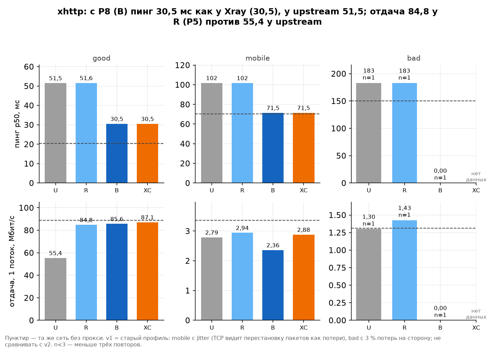
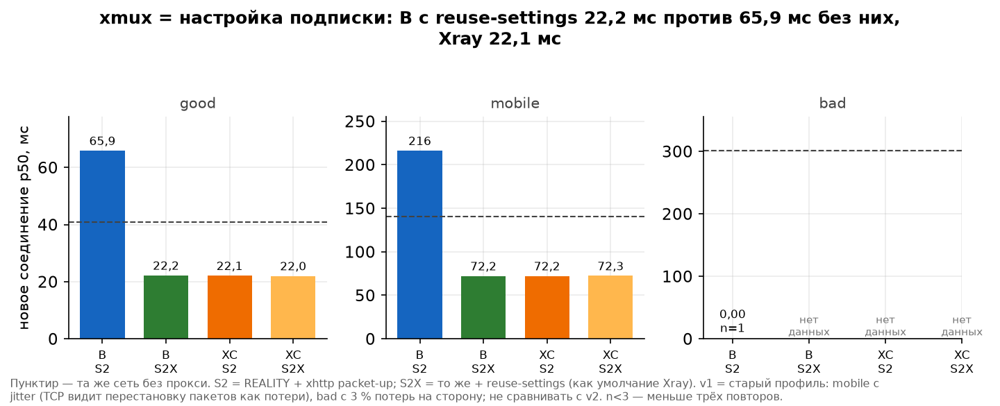
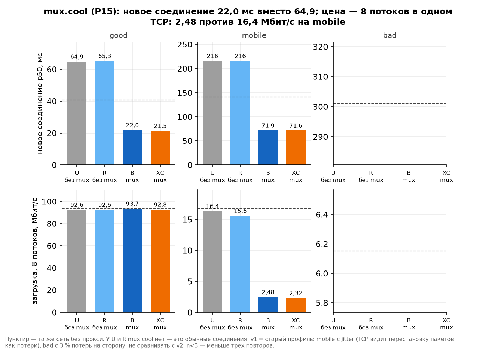
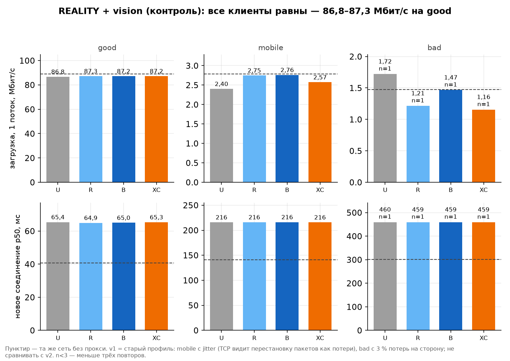
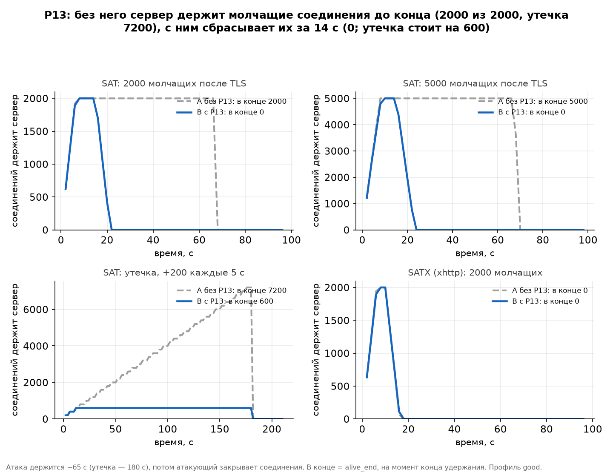
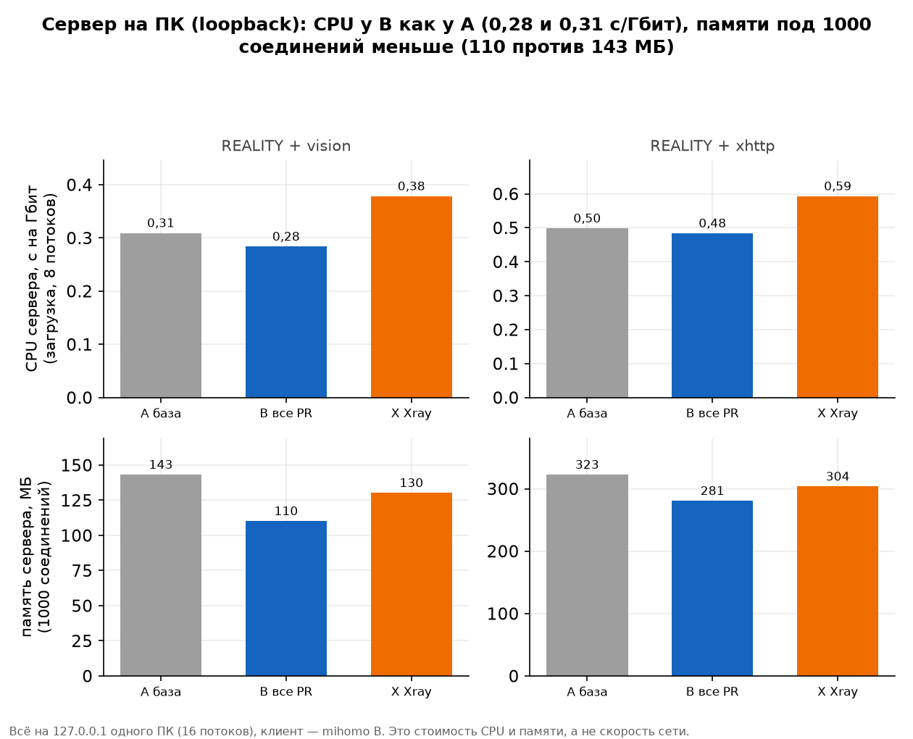

# Замеры ядра mihomo (форк BPN)

Здесь хранятся результаты замеров ядра: чтобы каждый патч можно было обосновать
цифрами «без патча / с патчем / Xray как эталон». Ветка `bpn/bench` — только
данные и скрипты, кода ядра в ней нет.

Таблицы и подписи графиков ниже между пометками `gen:` пишет `tools/charts.py`
из `data/runs.csv`; руками их не править.

## Стенд в пяти строках

1. Сетевой стенд: один Linux-сервер (1 поток CPU, 2 ГБ), клиент и сервер — два сетевых
   пространства, соединённые виртуальным кабелем; в интернет ничего не уходит.
2. Сеть задаёт `tc netem`: задержка, потери и скорость канала в каждую сторону (профили
   good / mobile / bad); перед прогоном меряется «голая» сеть без прокси — это пунктир на графиках.
3. Сервер в клиентских замерах один и тот же — Xray; меняется только клиент (U / R / B / XC).
   Каждый замер: скорость 1 и 8 потоков в обе стороны, пинг по открытому соединению,
   время нового соединения; повторяется 3 раза, в таблицах — медиана.
4. Атаки: тот же стенд, профиль good; меняется сервер (A без P13 / B с P13), атакующий держит
   тысячи соединений, честный клиент (mihomo B) в это время меряет задержку.
5. Loopback: всё на 127.0.0.1 одного ПК (16 потоков) — это цена CPU и памяти сервера, не сеть.

Кто есть кто:

- **U** — upstream mihomo v1.19.32 без наших патчей; **R** — ядро в Android-приложении
  (v1.19.32-bpn.2, патчи P1–P6); **B** — все PR (в том числе P8 xhttp и P15 mux.cool-клиент);
  **XC** — клиент Xray 26.9.9.
- Сценарии: **S1** REALITY + vision; **S2** REALITY + xhttp packet-up; **S2X** — S2 + reuse-settings
  (xmux как умолчание Xray: max-concurrency 1, h-max-request-times 600–900,
  h-max-reusable-secs 1800–3000); **S3M** — mux.cool (у U и R mux.cool нет, у них это обычные
  соединения); **SAT / SATX** — атаки на VLESS+TLS / xhttp+TLS после рукопожатия.
- В атаках **A** — сервер без P13 (тот же бинарник, что R), **B** — с P13.
  В loopback **A** — сервер `origin/bpn/v1.19.32`, **B** — все PR, **X** — Xray 26.9.9; клиент всегда mihomo B.
- **v1** у профиля — старая настройка сети: mobile с jitter, который переставляет пакеты
  (TCP принимает это за потери, один поток падает до 2–3 Мбит/с), и bad с 3 % потерь на
  сторону. Сравнивать клиентов внутри v1 можно, v1 с v2 — нельзя. **n=1/2** — меньше трёх повторов.

## Прогоны в реестре

<!-- gen:runs -->
| Прогон | Вид | Профиль | Сеть (RTT / jitter / потери на сторону / канал) | Пинг сети, мс | Повторов | Длительность, мин |
|---|---|---|---|---|---|---|
| 20261028-095404-full | loopback | loopback | 127.0.0.1 | — | — | 46 |
| 20261028-114138-full | netem | bad (v1) | 150 мс / 0 мс / 3 % / 8 Мбит/с | 151 | 1 | 196 |
| 20261028-114138-full | netem | good | 20 мс / 0 мс / 0 % / 100 Мбит/с | 20,3 | 3 | 196 |
| 20261028-114138-full | netem | mobile (v1) | 70 мс / 15 мс / 1 % / 30 Мбит/с | 71,1 | 3 | 196 |
| 20261028-155917-attack-full | attack | good | 20 мс / 0 мс / 0 % / 100 Мбит/с | 22,2 (ICMP, среднее) | — | 42 |
| 20261028-164058-full | netem | bad | 150 мс / 0 мс / 1 % / 8 Мбит/с | 150 | 1 | 244 |
| 20261028-164058-full | netem | far | 200 мс / 0 мс / 0.1 % / 100 Мбит/с | 222 (ICMP, среднее) | 0 | 244 |
| 20261028-164058-full | netem | good | 20 мс / 0 мс / 0 % / 100 Мбит/с | 20,4 | 3 | 244 |
| 20261028-164058-full | netem | mobile | 70 мс / 0 мс / 1 % / 30 Мбит/с | 70,4 | 3 | 244 |
<!-- /gen:runs -->

## Итог по патчам

Клиент (сервер — Xray, меняется клиент):

<!-- gen:clients -->
| Патч | Что меряем | Профиль | U upstream | R приложение | B все PR | XC Xray | Вывод |
|---|---|---|---|---|---|---|---|
| P8 xhttp | пинг p50, мс (S2) | good | 51,5 | 51,6 | 30,5 | 30,5 | доказано: B = Xray, U и R хуже |
| P8 xhttp | пинг p50, мс (S2) | mobile | 102 | 102 | 71,5 | 71,5 | 〃 |
| P8 xhttp | пинг p50, мс (S2) | bad | 183 (n=1) | 183 (n=1) | 0,00 (n=1) | — | 〃 |
| P5 xhttp (уже в R) | отдача 1 поток, Мбит/с (S2) | good | 55,4 | 84,8 | 85,6 | 87,1 | доказано: прирост даёт P5 (R = B), он уже в приложении; на mobile/bad упор в канал |
| P8 xhttp | новое соединение p50, мс (S2) | good | 96,8 | 96,4 | 65,9 | 22,1 | лучше U/R; Xray быстрее за счёт xmux — см. строку ниже |
| P8 xhttp | новое соединение p50, мс (S2) | mobile | 247 | 247 | 216 | 72,2 | 〃 |
| P8 xhttp | новое соединение p50, мс (S2) | bad | 491 (n=1) | 491 (n=1) | 0,00 (n=1) | — | 〃 |
| xmux (S2X) | новое соединение p50, мс (S2X) | good | 53,0 | 53,2 | 22,2 | 22,0 | доказано: с xmux в подписке B = Xray; U/R тоже ускоряются (настройка подписки, не код) |
| xmux (S2X) | новое соединение p50, мс (S2X) | mobile | 103 | 103 | 72,2 | 72,3 | 〃 |
| P15 mux.cool | новое соединение p50, мс (S3M) | good | 64,9 | 65,3 | 22,0 | 21,5 | доказано: B = Xray, быстрее U и R |
| P15 mux.cool | новое соединение p50, мс (S3M) | mobile | 216 | 216 | 71,9 | 71,6 | 〃 |
| P15 mux.cool | загрузка 8 потоков, Мбит/с (S3M) | good | 92,6 | 92,6 | 93,7 | 92,8 | цена: все потоки в одном TCP; у Xray так же |
| P15 mux.cool | загрузка 8 потоков, Мбит/с (S3M) | mobile | 16,4 | 15,6 | 2,48 | 2,32 | 〃 |
| P1–P6 (R) | REALITY+vision, загрузка 1 поток, Мбит/с (S1) | good | 86,8 | 87,3 | 87,2 | 87,2 | контроль: все равны, патчи не мешают |
| P1–P6 (R) | REALITY+vision, загрузка 1 поток, Мбит/с (S1) | mobile | 2,40 | 2,75 | 2,76 | 2,57 | 〃 |
| P1–P6 (R) | REALITY+vision, загрузка 1 поток, Мбит/с (S1) | bad | 1,72 (n=1) | 1,21 (n=1) | 1,47 (n=1) | 1,16 (n=1) | 〃 |
<!-- /gen:clients -->

Сервер (атаки, профиль good):

<!-- gen:server -->
| Патч | Сценарий | Что меряем | A без P13 | B с P13 | Вывод |
|---|---|---|---|---|---|
| P13 | SAT silent-2000 | 2000 молчащих после TLS: держит в конце | 2000 | 0 | доказано |
| P13 | SAT silent-5000 | 5000 молчащих после TLS: держит в конце | 5000 | 0 | доказано |
| P13 | SAT leak-200x5 | утечка +200/5 с, 180 с: держит в конце | 7200 | 600 | доказано: без P13 растёт без предела |
| P13 | SAT silent-5000 | 5000 молчащих: пик памяти, МБ | 178 | 179 | разницы нет — P13 рвёт, а не экономит |
| P13 | SATX silent-2000 | xhttp, 2000 молчащих: держит в конце | 0 | 0 | не доказано: A тоже сбрасывает |
| P13 | SATX leak-200x5 | xhttp, утечка: держит в конце | 400 | 400 | не доказано: одинаково |
| P13 | SAT byte-2000 | по байту: пик соединений | 340 | 342 | неинформативно: оба сервера рвут сразу |
| P13 | SAT silent-5000 | честный клиент: новое соединение p50, мс (спокойно → под атакой) | 63,9 → 64,1 | 64,2 → 65,1 | честному клиенту атака на этом стенде не мешает |
| P13 | SATX silent-5000 | честный клиент: новое соединение p50, мс (спокойно → под атакой) | 64,5 → 64,6 | 64,5 → 64,6 | честному клиенту атака на этом стенде не мешает |
<!-- /gen:server -->

## Графики

### P8: xhttp

<!-- gen:title-p8-xhttp -->
**xhttp: с P8 (B) пинг 30,5 мс как у Xray (30,5), у upstream 51,5; отдача 84,8 у R (P5) против 55,4 у upstream**
<!-- /gen:title-p8-xhttp -->



### xmux — это настройка подписки, а не патч

<!-- gen:title-xmux-connect -->
**xmux = настройка подписки: B с reuse-settings 22,2 мс против 65,9 мс без них, Xray 22,1 мс**
<!-- /gen:title-xmux-connect -->



### P15: mux.cool — плюсы и цена

<!-- gen:title-mux-cool -->
**mux.cool (P15): новое соединение 22,0 мс вместо 64,9; цена — 8 потоков в одном TCP: 2,48 против 16,4 Мбит/с на mobile**
<!-- /gen:title-mux-cool -->



### Контроль: REALITY + vision

<!-- gen:title-reality-control -->
**REALITY + vision (контроль): все клиенты равны — 86,8–87,3 Мбит/с на good**
<!-- /gen:title-reality-control -->



### P13: атака на сервер

<!-- gen:title-p13-attack -->
**P13: без него сервер держит молчащие соединения до конца (2000 из 2000, утечка 7200), с ним сбрасывает их за 14 с (0; утечка стоит на 600)**
<!-- /gen:title-p13-attack -->



### Сервер на ПК: стоимость CPU и памяти (loopback, не сеть)

<!-- gen:title-loopback-cost -->
**Сервер на ПК (loopback): CPU у B как у A (0,28 и 0,31 с/Гбит), памяти под 1000 соединений меньше (110 против 143 МБ)**
<!-- /gen:title-loopback-cost -->



<!-- gen:loopback -->
| Сценарий | Что меряем | A база | B все PR | X Xray |
|---|---|---|---|---|
| S1 | загрузка 8 потоков, Мбит/с | 13466 | 13305 | 12522 |
| S1 | CPU сервера, с/Гбит (загрузка, 8 потоков) | 0,31 | 0,28 | 0,38 |
| S1 | CPU сервера, с/Гбит (отдача, 8 потоков) | 0,31 | 0,24 | 0,45 |
| S1 | память сервера при 1000 соединений, МБ | 143 | 110 | 130 |
| S1 | 1000 соединений: открыть + 20 эхо, с | 1,22 | 1,39 | 1,23 |
| S2 | загрузка 8 потоков, Мбит/с | 12338 | 11534 | 10252 |
| S2 | CPU сервера, с/Гбит (загрузка, 8 потоков) | 0,50 | 0,48 | 0,59 |
| S2 | CPU сервера, с/Гбит (отдача, 8 потоков) | 0,62 | 0,59 | 0,82 |
| S2 | память сервера при 1000 соединений, МБ | 323 | 281 | 304 |
| S2 | 1000 соединений: открыть + 20 эхо, с | 1,89 | 1,79 | 1,70 |
<!-- /gen:loopback -->

## Что не доказано и почему

- **P13 на xhttp (SATX) — разницы нет.** Сервер без P13 тоже сбрасывает молчащие
  xhttp-соединения почти в то же время, что и с P13 (график, нижний правый). Для xhttp патч
  на этом стенде ничего не меняет; польза P13 доказана только для VLESS поверх TLS (SAT).
- **Режим byte (по байту) неинформативен.** Атакующий шлёт байт, который сразу ломает
  разбор, и оба сервера рвут соединение в первые секунды — время удержания
  не зависит от P13.
- **P13 не экономит память на пике:** пока соединения живы, A и B держат их одинаково;
  разница в том, что B их отпускает через секунды после рукопожатия (см. заголовок графика P13).
- **xmux (S2X)** замерен в прогоне 2 (good, mobile): с reuse-settings в подписке новое соединение у B — как у Xray; у U и R вдвое быстрее, чем без xmux, но медленнее B (нужен ещё P8). Профили bad/far прогона 2 — перезапущены с меньшими объёмами, добавятся отдельно.
- **R на good** нет: в начале прогона 1 бинарника R не было (`failed.txt`), на mobile у R два повтора.
- **mobile и bad пока только v1**, bad — один повтор. Цена mux.cool на mobile v1 (один TCP на
  восемь потоков) завышена jitter'ом; честная цифра будет на mobile v2.
- **P5 (в R)** рассчитан на xhttp через CDN с запросами GET; стенд такого канала не
  имитирует, поэтому R здесь равен U.
- **P2, P7, P9** стенд не проверяет (отпечатки TLS, подмена отпечатка, транспорт xdrive) —
  владелец сказал их пока не трогать.
- **Loopback** показывает цену CPU и памяти одного сервера на быстром ПК; скорость там
  упирается в процессор, а не в сеть, и разброс между повторами большой — выводов
  о скорости по нему не делаем.

## Как добавить прогон

```
python tools/collect.py <папка результатов> [<папка> ...]
python tools/charts.py
```

- Папка — это `.bench/netem/results/<прогон>` (сетевой стенд или атаки) или
  `.bench/results/<прогон>` (loopback). Вид определяется сам.
- Повторный запуск того же прогона заменяет его строки, остальные прогоны остаются.
  Без аргументов `collect.py` перечитывает все папки из `data/meta.csv`.
- Профиль сетевого прогона берётся, только если стенд его закончил (`results.json` есть),
  поэтому идущий прогон можно добавлять по частям. Пробные `quick`-прогоны (1 повтор)
  не записываются.
- Версия профиля (v1/v2) определяется по фактическим настройкам netem; если профили в
  `.bench/netem/lib.sh` поменяются, обновите `CURRENT_SPECS` в `tools/collect.py`.
- Для каждого профиля графики берут самый новый прогон; v1 скрывается, как только
  появляется v2 того же профиля. Вывод в заголовке графика собирается из цифр; текст вывода
  в таблице патчей (`CLIENT_ROWS`, `SERVER_ROWS` в `tools/charts.py`) после нового прогона
  перечитать глазами.

## Файлы

- `data/runs.csv` — одна строка = прогон × профиль × сценарий × клиент × сервер × вариант ×
  повтор × метрика; строки `repeat=median` — медиана по повторам, `n` — сколько повторов.
  Метрика — путь в JSON стенда (`ping_us.p50`, `download_8.mbps`, `load.1000.server.rss_peak_mb`,
  `attack.alive_end`…); `*.server.cpu_s_per_gbit` — CPU-секунды сервера на гигабит, посчитано
  так же, как в отчёте стенда.
- `data/meta.csv` — прогон × профиль: дата, настройки netem (RTT, jitter, потери на сторону,
  канал), измеренный пинг и скорость голой сети, число повторов, строк в `failed.txt`,
  длительность, хэши бинарников (первые 12 знаков sha256).
- `data/attack_samples.csv` — ряды атаки раз в 2 с: сколько соединений держит сервер,
  память, CPU, потоки.
- `tools/collect.py`, `tools/charts.py` — Python 3, только стандартная библиотека и matplotlib.
